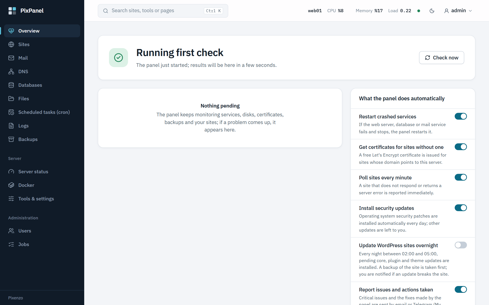
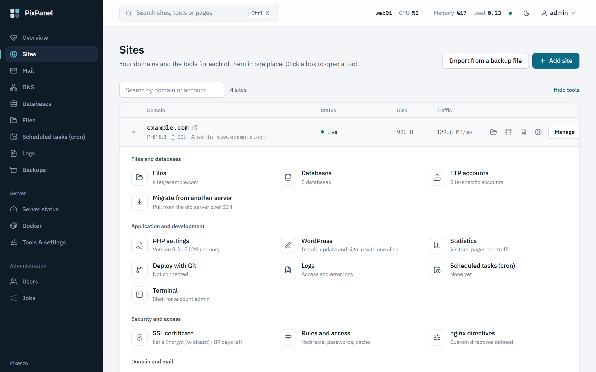
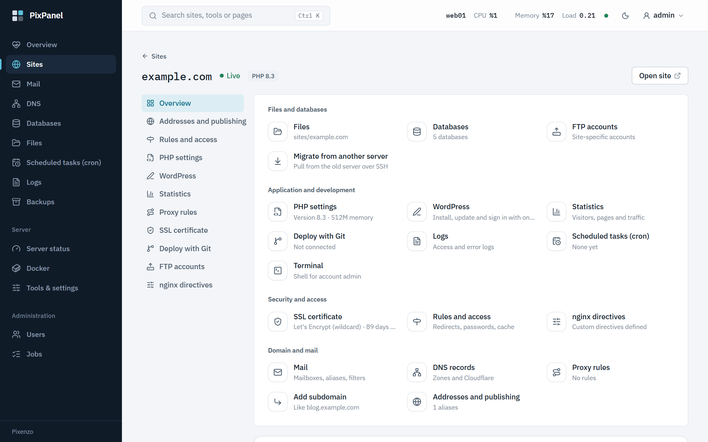
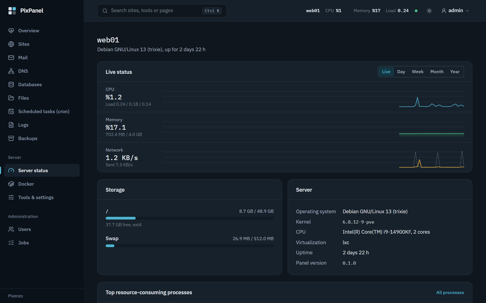
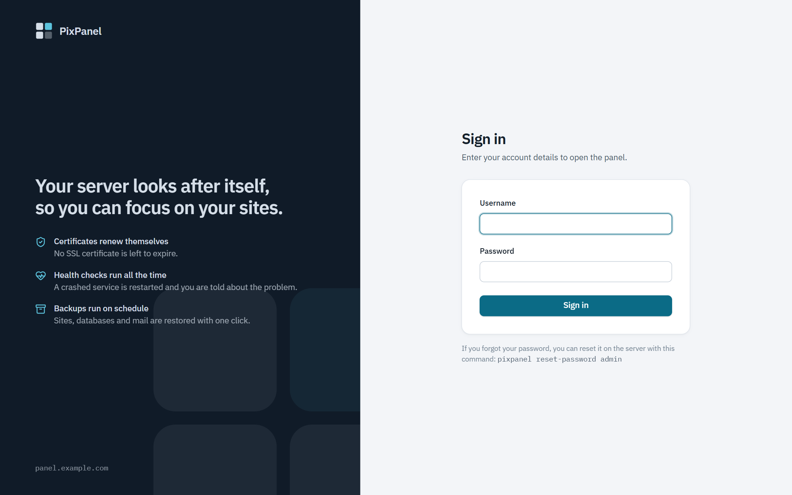
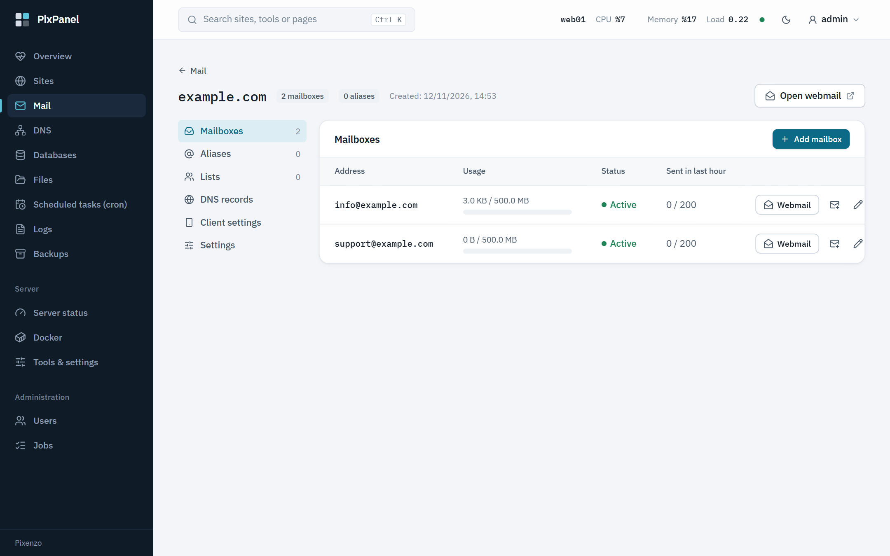
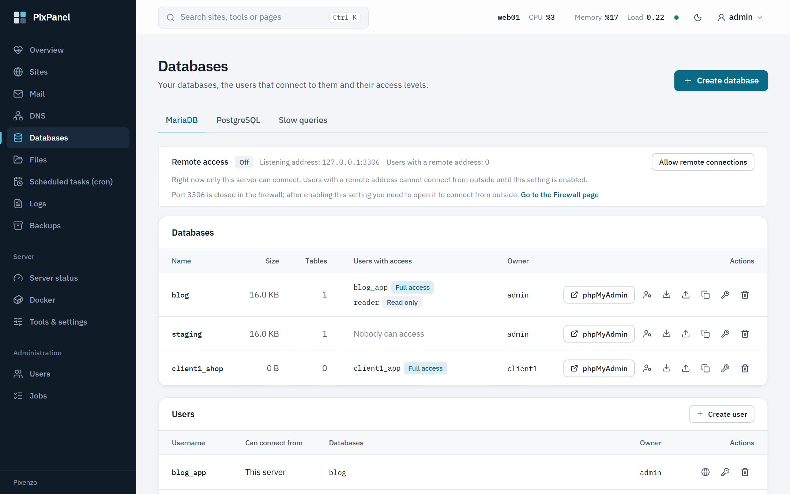
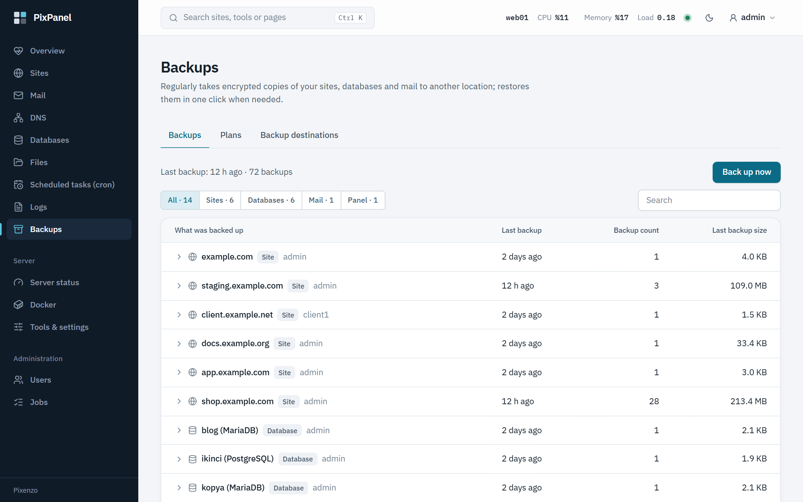
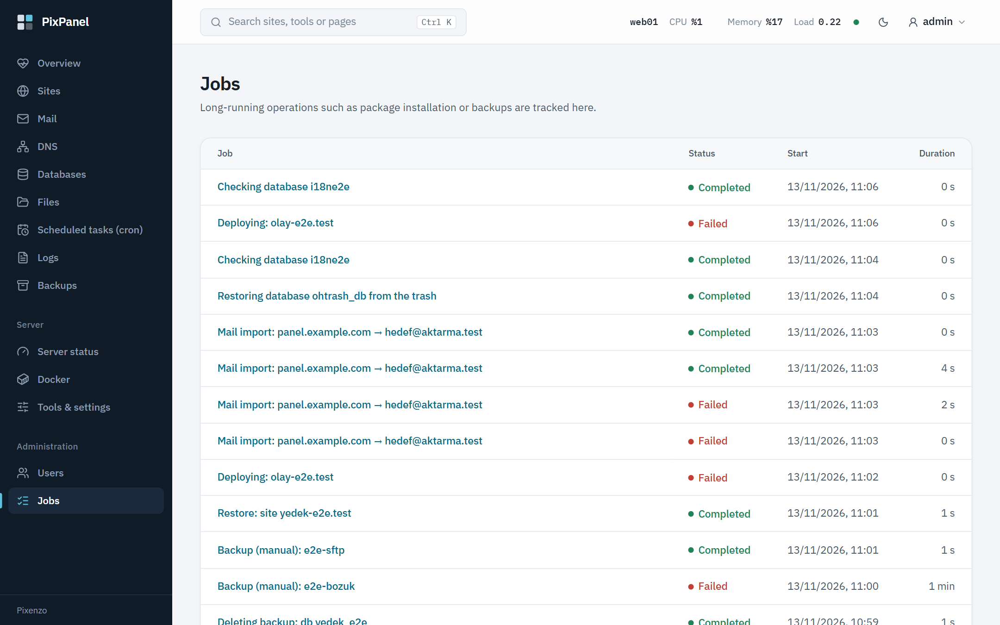
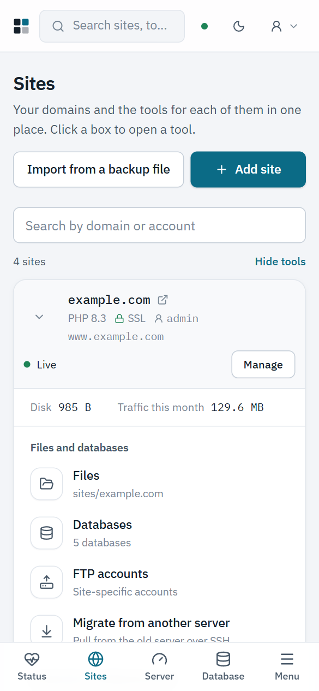

<div align="center">

# PixPanel

**A self-hosted web hosting control panel that does the routine work for you.**

**English** · [Türkçe](README.tr.md)



</div>

PixPanel manages sites, databases, mail, DNS and backups on your own server from one place. The chores a web admin repeats every week are handled by the panel itself: certificates renew, security updates install, backups run on schedule, crashed services restart, and a health check every minute tells you what needs attention and offers a one-click fix.

It is a [Pixenzo](https://github.com/Pixenzo) product. The whole panel is a single static binary with the web interface embedded in it; there is no runtime to install and no separate web server for the panel.

> **Status:** [version 0.1.0](https://github.com/Pixenzo/pixpanel/releases/latest) is the first public release. It is tested end to end on clean Debian 13 and Ubuntu 26.04 machines, but it has not run in production yet; try it on a server you can afford to rebuild.

## Screenshots

| | |
|---|---|
|  Sites and the tools of each one |  Every tool of a site on one page |
|  Live server metrics (dark theme) |  Sign-in page, brandable per reseller |
|  Mail domains and mailboxes |  MariaDB and PostgreSQL |
|  Encrypted backups, one-click restore |  Long-running jobs with live logs |

<p align="center"><br>The whole interface works on a phone.</p>

## Features

- **Sites:** nginx, PHP-FPM with a separate Linux user per site (PHP 7.4–8.5), Node.js and Python apps, static sites; deploy with Git, staging environments, site cloning.
- **SSL:** Let's Encrypt (HTTP-01, and DNS-01 for wildcard certificates), custom certificates, automatic renewal, HTTP/3.
- **Databases:** MariaDB, PostgreSQL, Redis; phpMyAdmin and Adminer; imports, remote access (TLS required), a trash for deleted databases.
- **Mail:** Postfix, Dovecot, Rspamd, Roundcube; DKIM, quarantine, mailing lists, optional virus scanning.
- **DNS:** local zones with PowerDNS, DNSSEC, secondary servers; Cloudflare integration.
- **Backups:** restic to local, SFTP, S3 and FTP destinations; scheduled plans, one-click restore.
- **WordPress:** install, update, hardening, nightly maintenance, installs in subfolders.
- **Accounts:** admin, reseller, customer and sub-accounts; packages and quotas, traffic limits, reseller branding, two-factor authentication, scoped API keys.
- **Server:** live metrics, service management, firewall and fail2ban, system updates, health center and weekly summary.
- **Migration:** pull a site from another server over SSH; import from cPanel, Plesk and HestiaCP backup files.

## What the panel does on its own

- Issues certificates for sites that have none and renews them before they expire.
- Installs operating system security updates daily.
- Restarts web, database and mail services that crash.
- Checks every site once a minute and reports the ones that stop responding.
- Runs backup plans and prunes old copies.
- Optionally updates WordPress sites overnight, taking a backup first.

Each of these can be switched off on the Overview page.

## Requirements

Debian 13 or Ubuntu 26.04, x86_64, root access. A clean server is recommended.

## Installation

```
curl -fsSL https://github.com/Pixenzo/pixpanel/releases/latest/download/install.sh | bash
```

The script verifies the signature of the release files, installs the panel and shows the first admin password once. The panel opens at `https://<server>:8443`. Running the same command again upgrades the panel to the latest release.

For an offline install, copy the release files to the server and run `bash install.sh --from-dir <folder>`. To remove the panel: `pixpanel-uninstall` (keeps settings and data) or `pixpanel-uninstall --purge`.

## Building from source

The backend is Rust (axum, SQLite); the interface is React 19 + Vite + Tailwind 4.

```
cd web && pnpm install && pnpm build
cd ../server && cargo build --release
```

For a release package: `scripts/release.sh <version>`.

## Languages

The interface is available in Turkish and English; each user picks a language under Account. Messages produced by the server (error messages, health findings, job logs, notification emails) follow the same choice; API clients select it with the `Accept-Language` header. The `pixpanel` command line and the install script print Turkish only.

## Documentation

The documentation is written in Turkish.

- [`docs/DURUM.md`](docs/DURUM.md): what is finished, what is tested, known limits
- [`docs/YOL-HARITASI.md`](docs/YOL-HARITASI.md): roadmap
- [`docs/api.md`](docs/api.md): API endpoints
- [`docs/komut-satiri.md`](docs/komut-satiri.md): the `pixpanel` command line
- [`docs/infra/`](docs/infra): releasing and disaster recovery

## Security

Commands are run as a program plus an argument list, never through a shell; every name coming from a user is validated against an allow-list; user files are accessed by a process running as that user. If you find a vulnerability, please report it privately through GitHub's "Report a vulnerability" button on the Security tab instead of opening a public issue.

## License

No license has been chosen yet; until one is, all rights are reserved by Pixenzo.
