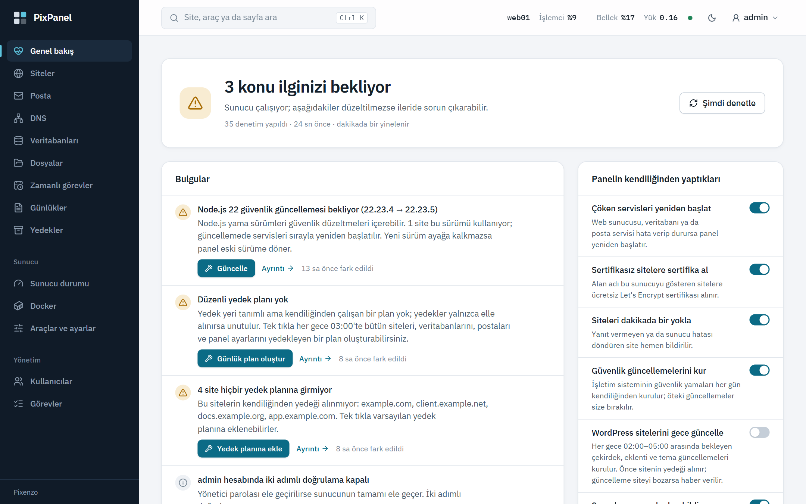
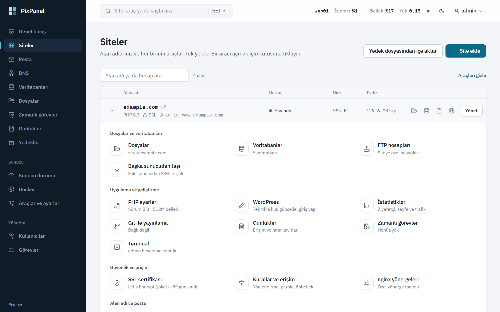
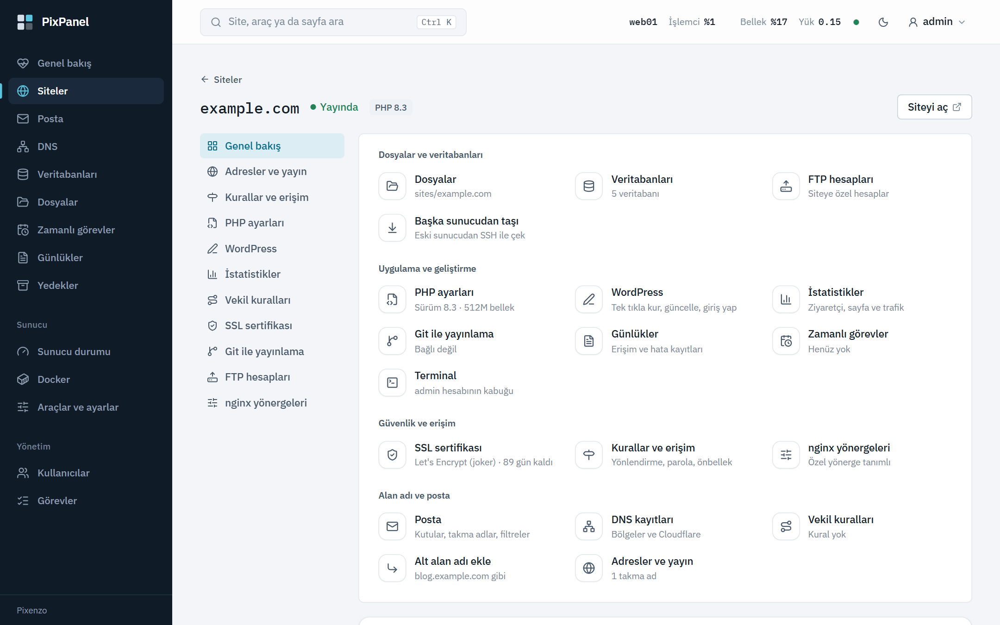
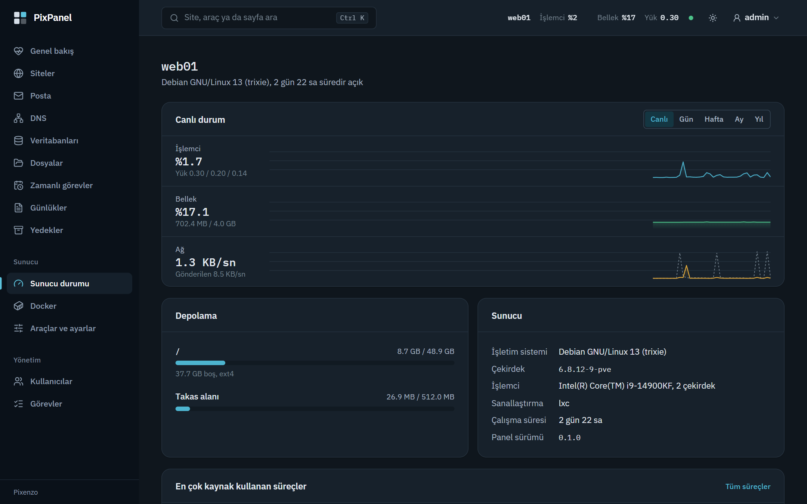
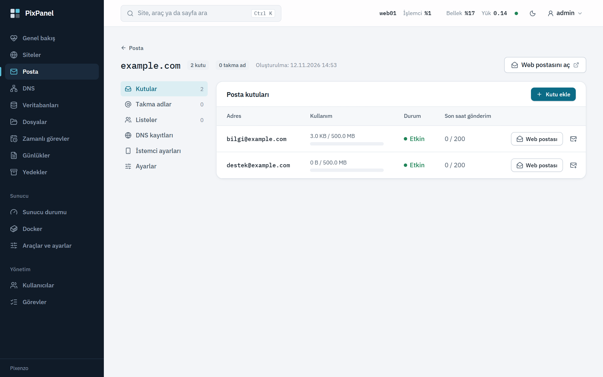
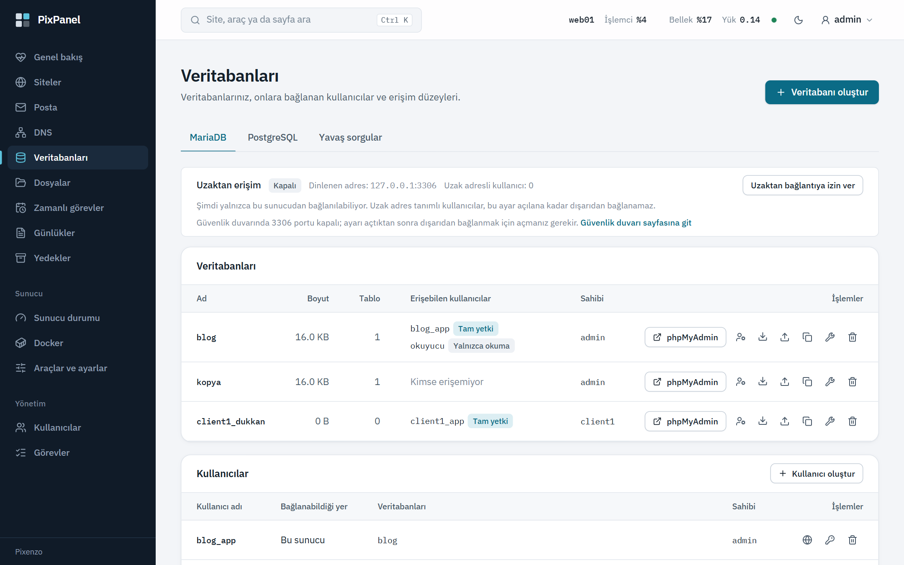
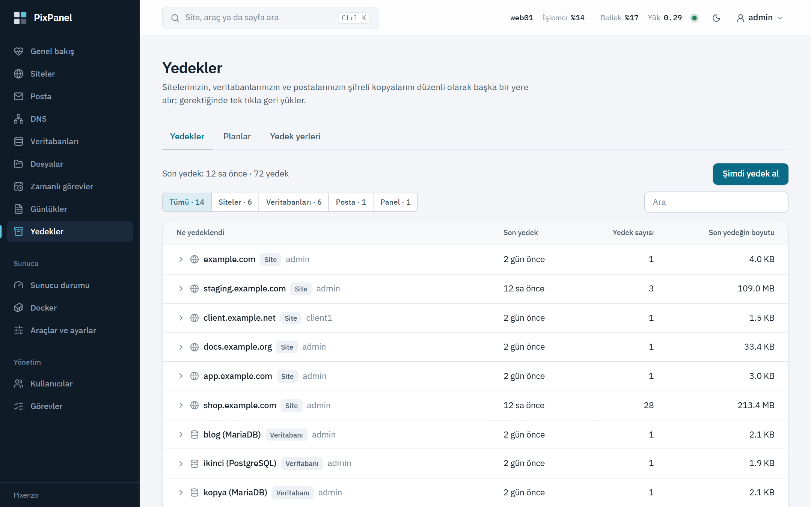
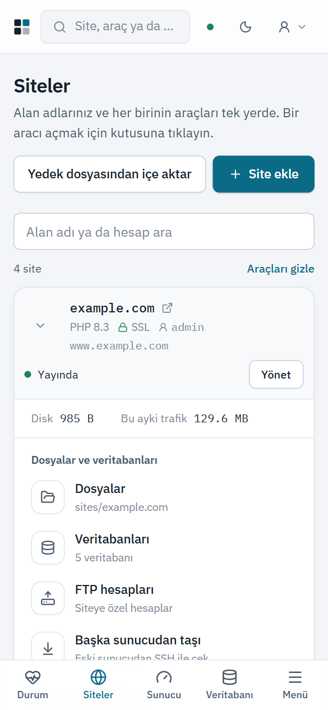

<div align="center">

# PixPanel

**Rutin işleri sizin yerinize yapan, kendi sunucunuzda çalışan web barındırma paneli.**

[English](README.md) · **Türkçe**



</div>

PixPanel siteleri, veritabanlarını, postayı, DNS'i ve yedekleri kendi sunucunuzda tek yerden yönetir. Bir web yöneticisinin her hafta yinelediği işleri panel kendisi yapar: sertifikalar yenilenir, güvenlik güncellemeleri kurulur, yedekler zamanında alınır, çöken servisler yeniden başlatılır; dakikada bir çalışan sağlık denetimi neyin ilgi beklediğini söyler ve tek tıkla düzeltmeyi önerir.

Bir [Pixenzo](https://github.com/Pixenzo) ürünüdür. Panelin tamamı tek bir statik ikili dosyadır, arayüz içine gömülüdür; ayrıca kurulacak bir çalışma ortamı ya da panel için ayrı bir web sunucusu yoktur.

> **Durum:** [0.1.0](https://github.com/Pixenzo/pixpanel/releases/latest) ilk açık sürümdür. Temiz Debian 13 ve Ubuntu 26.04 makinelerinde uçtan uca sınandı, ancak henüz canlı ortamda çalışmadı; yeniden kurmayı göze alabileceğiniz bir sunucuda deneyin.

## Ekran görüntüleri

| | |
|---|---|
|  Siteler ve her sitenin araçları |  Bir sitenin bütün araçları tek sayfada |
|  Canlı sunucu ölçümleri (koyu tema) |  Posta alanları ve kutuları |
|  MariaDB ve PostgreSQL |  Şifreli yedekler, tek tıkla geri yükleme |

<p align="center"><br>Arayüzün tamamı telefonda da çalışır.</p>

## Özellikler

- **Siteler:** nginx, site başına ayrı kullanıcıyla PHP-FPM (PHP 7.4–8.5), Node.js ve Python uygulamaları, statik siteler; Git ile yayınlama, hazırlık ortamı, site kopyalama.
- **SSL:** Let's Encrypt (HTTP-01 ve joker sertifika için DNS-01), kendi sertifikanızı yükleme, otomatik yenileme, HTTP/3.
- **Veritabanları:** MariaDB, PostgreSQL, Redis; phpMyAdmin ve Adminer; içe aktarma, uzaktan erişim (TLS zorunlu), silinenler için çöp kutusu.
- **Posta:** Postfix, Dovecot, Rspamd, Roundcube; DKIM, karantina, posta listeleri, isteğe bağlı virüs taraması.
- **DNS:** PowerDNS ile yerel bölgeler, DNSSEC, ikincil sunucu; Cloudflare bağlantısı.
- **Yedekleme:** restic ile yerel, SFTP, S3 ve FTP hedefleri; zamanlanmış planlar, tek tıkla geri yükleme.
- **WordPress:** kurulum, güncelleme, güvenlik sıkılaştırma, gece bakımı, alt klasördeki kurulumlar.
- **Hesaplar:** yönetici, bayi, müşteri ve alt hesap; paketler ve kotalar, trafik sınırı, bayi markası, iki adımlı doğrulama, kapsamlı API anahtarları.
- **Sunucu:** canlı ölçümler, servis yönetimi, güvenlik duvarı ve fail2ban, sistem güncellemeleri, sağlık merkezi ve haftalık özet.
- **Taşıma:** başka sunucudan SSH ile site taşıma; cPanel, Plesk ve HestiaCP yedek dosyalarından içe aktarma.

## Panelin kendiliğinden yaptıkları

- Sertifikası olmayan sitelere sertifika alır, süresi dolmadan yeniler.
- İşletim sisteminin güvenlik güncellemelerini her gün kurar.
- Çöken web, veritabanı ve posta servislerini yeniden başlatır.
- Her siteyi dakikada bir yoklar, yanıt vermeyeni bildirir.
- Yedek planlarını çalıştırır, eski kopyaları temizler.
- İstenirse WordPress sitelerini gece günceller; önce yedeğini alır.

Bunların her biri Genel bakış sayfasından kapatılabilir.

## Gereksinimler

Debian 13 ya da Ubuntu 26.04, x86_64, root erişimi. Temiz bir sunucu önerilir.

## Kurulum

```
curl -fsSL https://github.com/Pixenzo/pixpanel/releases/latest/download/install.sh | bash
```

Betik sürüm dosyalarının imzasını doğrular, paneli kurar ve ilk yönetici parolasını bir kez gösterir. Panel `https://<sunucu>:8443` adresinde açılır. Aynı komut yeniden çalıştırılırsa paneli son sürüme yükseltir.

Çevrimdışı kurulum için sürüm dosyalarını sunucuya kopyalayıp `bash install.sh --from-dir <klasör>` çalıştırın. Kaldırmak için: `pixpanel-uninstall` (ayar ve veriler kalır) ya da `pixpanel-uninstall --purge`.

## Kaynaktan derleme

Arka uç Rust (axum, SQLite), arayüz React 19 + Vite + Tailwind 4.

```
cd web && pnpm install && pnpm build
cd ../server && cargo build --release
```

Sürüm paketi için: `scripts/release.sh <sürüm>`.

## Diller

Arayüz Türkçe ve İngilizce kullanılabilir; her kullanıcı dilini Hesabım sayfasından seçer. Sunucunun ürettiği metinler (hata iletileri, sağlık bulguları, görev günlükleri) şimdilik yalnızca Türkçedir.

## Belgeler

- [`docs/DURUM.md`](docs/DURUM.md): neyin bittiği, neyin sınandığı, bilinen sınırlar
- [`docs/YOL-HARITASI.md`](docs/YOL-HARITASI.md): yol haritası
- [`docs/api.md`](docs/api.md): API uçları
- [`docs/komut-satiri.md`](docs/komut-satiri.md): `pixpanel` komut satırı
- [`docs/infra/`](docs/infra): sürüm yayınlama ve felaket kurtarma

## Güvenlik

Komutlar kabuk üzerinden değil, program ve argüman dizisi olarak çalıştırılır; kullanıcıdan gelen her ad beyaz listeyle doğrulanır; kullanıcı dosyalarına o kullanıcının kimliğiyle çalışan süreç erişir. Bir açık bulursanız lütfen herkese açık kayıt açmak yerine deponun Security sekmesindeki "Report a vulnerability" düğmesiyle özel olarak bildirin.

## Lisans

Lisans henüz belirlenmedi; belirlenene kadar tüm hakları Pixenzo'ya aittir.
